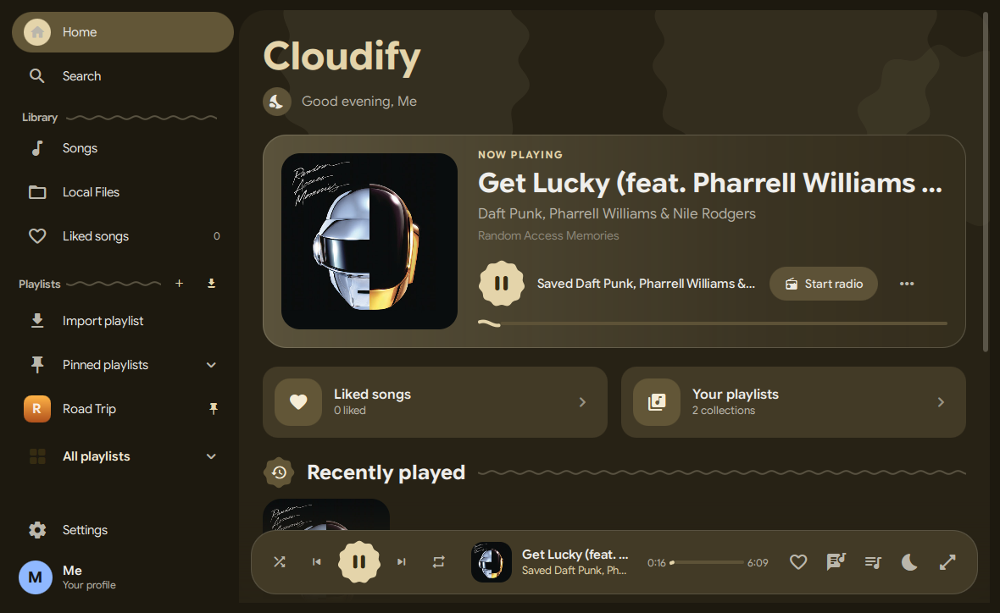
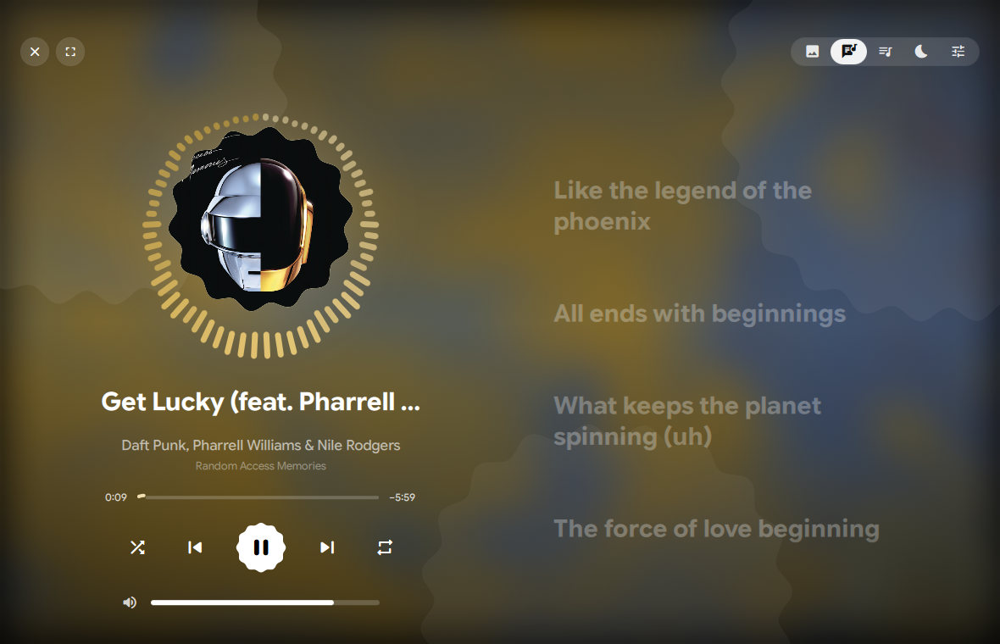
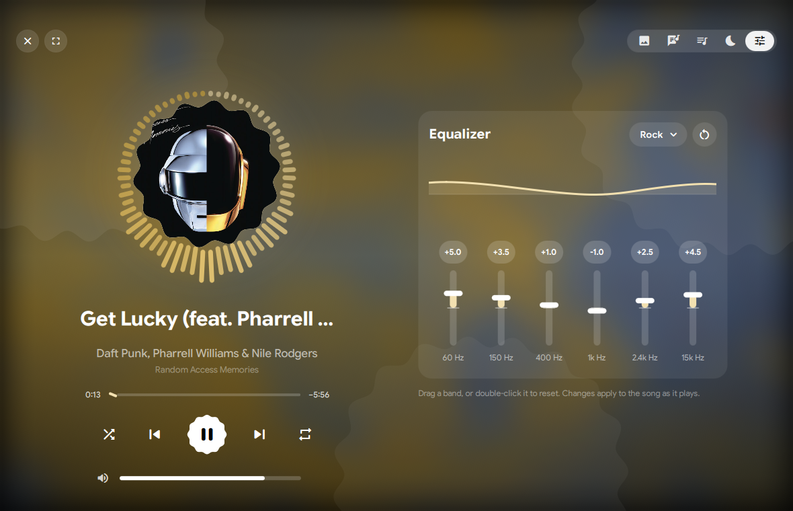
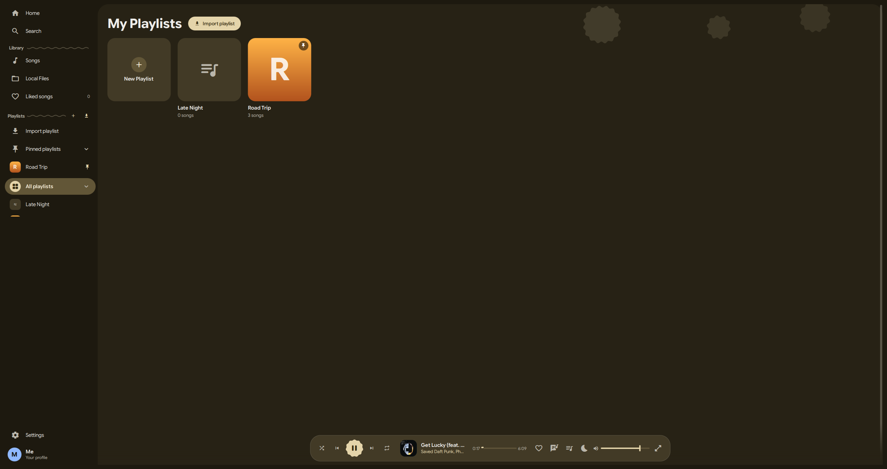
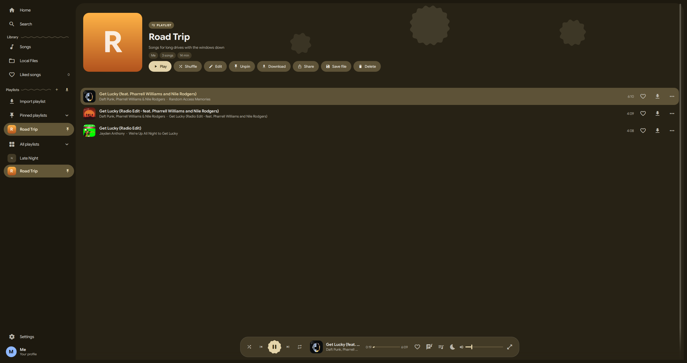

<p align="center">
  
</p>

<h1 align="center">Cloudify</h1>

<p align="center">
  A fast, light music player for Windows. Search YouTube Music, play instantly, and keep your playlists.<br>
  Built in Rust with a Qt Quick interface, by <b>weepingcloud</b>.
</p>

<p align="center">
  
</p>

## Why Cloudify

- **Light and quick.** Rust core, no web view and no media framework. It idles at a few megabytes and plays on about 1 % CPU. Songs start while they are still downloading.
- **Looks good.** Material-style design with scalloped shapes, wavy seek bars and soft motion. The whole app takes its colors from the album that is playing.
- **Your music, your way.** Playlists, liked songs, daily mixes, local files, import and export.

## Features

| | |
|---|---|
| **Search** | Songs, albums and artists from YouTube Music, plus Spotify results if you add your own API keys. |
| **Immersive player** | Full-window player with a spectrum ring around the cover, a blurred backdrop in the cover's colors, synced lyrics, an up-next queue, a sleep timer and a six-band equalizer. |
| **Playlists** | Create, edit and pin playlists. Pick a cover photo or one of the generated designs. Pinned and all playlists show in the sidebar. |
| **Import and export** | Import from a YouTube or Spotify link, from Spotify through the built-in Exportify window, from a CSV, or from a share code. Export a playlist as a share code or a `.cloud` file. |
| **Daily mixes** | Six mixes every day, built from the songs you like and play. |
| **Local files** | Scan your Music folder (or any folder) and play mp3, flac, ogg, wav and m4a files. |
| **Queue tools** | Play next, add to queue, remove from queue, recently played. |
| **Themes** | 16 color themes, dark, light and AMOLED, or follow the album art. |
| **Downloads** | Save songs to `Music\Cloudify` with title, artist and album tags. |
| **Auto-update** | Checks GitHub for a new version and installs it for you. |

<p align="center">
  
  
</p>
<p align="center">
  
  
</p>

## Install

1. Download `Cloudify-Setup-<version>.exe` from the [latest release](../../releases/latest).
2. Run it. No administrator rights are needed.
3. After that, Cloudify updates itself.

Windows may show a SmartScreen warning because the installer is not code-signed yet. Choose **More info**, then **Run anyway**.

## Build from source

You need Rust, Qt 6.10 (MSVC 2022 64-bit) and Inno Setup 6.

```powershell
$env:QMAKE = "C:\Qt\6.10.3\msvc2022_64\bin\qmake.exe"
$env:Path = "C:\Qt\6.10.3\msvc2022_64\bin;$env:Path"
cargo run --release
powershell -File tools\stage.ps1        # builds and prepares the installer folder
```

## Publishing an update

Set your repository in `REPO` (top of `src/update.rs`), sign in with the GitHub CLI (`gh auth login`), then:

```powershell
powershell -File tools\release.ps1 -Version 0.17.0 -Notes "What changed"
```

This builds the installer, writes its SHA-256, and creates the release. Installed copies offer the update on their next start and check the checksum before installing.

## Credits

- Interface design and shaders from Swiftify by shred0s (GPL-3.0).
- Rewritten from Silva Music.
- Songs come from YouTube Music through [yt-dlp](https://github.com/yt-dlp/yt-dlp). Lyrics come from [lrclib.net](https://lrclib.net).
- Fonts: Google Sans Flex and Material Icons.

## License

GPL-3.0-or-later. See [LICENSE](LICENSE).
